# Progress

Newest milestone first. Requirement IDs refer to [DESIGN.md](DESIGN.md).

## After M7 — on real hardware (2026-10-24)

twm now runs as the desktop on a ThinkPad (Intel graphics, a 1920×1200 panel,
an ELAN touchpad and touchscreen), started from Draftpaper's login screen.

**Done**
- A session: `twm-session` and a "Tom's WM" entry in `wayland-sessions`,
  installed by meson; Draftpaper's greeter gained a session picker.
- Apps that draw their own shadows (Firefox, Electron) sat up and to the left
  of their frames: twm subtracted their window-geometry offset twice. Fixed,
  and what a client draws outside its geometry is cut off (P-2).
- A window that resizes itself (foot on a font change) keeps that size
  (OUT-17); tabs in a group keep sharing one, changed only by a resize.
- Touchpad settings (INP-1, INP-2): tap, tap-and-drag, natural scrolling,
  resting while typing, scroll and click methods, speed, acceleration — keys
  in `.twmrc`, applied through libinput on start and on every reload, and a
  "Touchpad & touch" section in Settings.
- The touchscreen (INP-3 … INP-6): touch for apps that take it, and
  elsewhere a finger is the pointer; mapped to the built-in panel.
- A close box on the tab (FRM-19): B1 closes, B3 kills (twm's
  f.destroy); `M-w` / `M-S-w`; `close` and `kill` in the root menu;
  `CloseBox off` for B0's tab.
- Running apps (IMG-13): the installed applications (`.desktop` entries) in
  the Icon Manager's RUN results, run directly; `M-d` (and `run…`) brings
  the Icon Manager up to type into.
- Volume and brightness keys (LVL-1 … LVL-4), through the system's own
  tools (wpctl, pactl, amixer, mixer; brightnessctl, sysfs, backlight), the
  new level as one root line that changes in place; `VolumeStep`,
  `BrightnessStep`.
- Squeeze acts on a whole tab group (GRP-9); folding moved to M-B3.
- Zoom and fullscreen (ZOM-1 … ZOM-9): twm's `f.zoom`, `f.horizoom` and
  `f.fullzoom` (`M-Up`), framed, over the usable area; `f.fullscreen`
  (`M-S-f`), the client alone over its output, above the bars while
  focused and stepping back when not. App requests (xdg maximize and
  fullscreen, X11 `_NET_WM_STATE` including vertical-only and
  horizontal-only maximize) map onto them, and windows that open
  maximized or fullscreen skip click-to-place. Undo takes them back;
  remembered geometry never stores a zoomed one. A fullscreen window that
  captures the screen carries an alert line along the top and the SCREEN
  marker at the top-right corner (ZOM-6, CAP-2).
- FreeBSD 15.1 tested in a VM; CI green on Arch, Debian and FreeBSD.

**Tests**: `shot-apps_close` runs an app found by name and checks the close
box: B1 asks the window to close, B3 cuts another client off and leaves the
test's own alone, `CloseBox off` narrows the tab; a shadowed client fills its frame with no shadow showing; a touch
reaches a window at the finger, and a finger drags a title like the pointer
without the app seeing it (`--test`'s own touchscreen, INP-6); the Settings
section is driven by keys. `shot-zoom` drives each zoom by key and by
app request, checks the client's size and the states it is told, undo, a
fullscreen window stepping back under a newly focused one and coming
forward again, a window that opens maximized, and the marker over a
capturing fullscreen client.

**Not verified**: the touchpad settings and the touchscreen on the real
devices (the tests have neither); an app that takes touch on the real panel.
X11 maximize and fullscreen (the tests run without XWayland).

## M7 — Settings, as a file (2026-10-24)

**Done**

- The Settings window (SET-1…14), `settings — ~/.twmrc`, as on B8: `M-,`
  or `settings` in the root menu. Sections down the left with a
  `filter keys…` field (typing filters); each row shows its label, its
  control and the key it writes, which turns accent with `●` once changed;
  a preview of a focused and an unfocused tab with the pending values; and
  the diff pane, always visible: `N changes`, the unified diff with line
  numbers (removed in alert, added in ok, context dim), the `twm --check`
  result, Discard and Write.
- B8's Frames controls exactly (squeeze segments, title height slider,
  hatch checkbox, outline/opaque, snap checkboxes, accent swatches and
  hex), plus Look, Focus, Desktops, Outputs and Privacy controls for the
  other simple keys. Bindings, Output rules and menus are listed read-only,
  with a button that opens the file in `$EDITOR`.
- It is not a second source of truth: it holds pending edits to the file.
  Writing changes only the edited values (comments, spacing and order
  kept), appends new keys, writes atomically (through symlinks) and
  applies at once. A hand edit of the file updates the controls. An
  invalid value shows in the diff and the check line, and can't be
  written.
- `M-z` while Settings has focus undoes the last pending change, then the
  last write; `M-S-z` redoes (HIS-5). Everything works from the keyboard:
  arrows, Space, Return, Tab for sections, `Ctrl-S` write, `Ctrl-D` discard.
- The window is resizable (B8 shows a resize box); a bigger one shows more
  of the diff. Internal windows can now be resizable in general.
- A pure module with unit tests: in-place `.twmrc` edits and the line diff
  (`unit-rcedit`).
- `Panner { desktops N off }` keeps the desktop count with the Panner
  hidden (the Settings toggle needed it).

**Screenshot test** `shot-m7_settings` (26 checks), on a real `~/.twmrc`
with comments: opens focused on Frames; the slider to 28 and ticking
"output centre" light the keys, the diff shows the removed and added lines
and `2 changes`, the file is untouched; the mint swatch turns the preview
mint while the desktop stays amber, and `M-z` takes it back; Write produces
exactly the expected file (one value changed, one key appended, comments
kept) and the tab is 28 px at once; `M-z` puts the old file back and
applied, `M-S-z` writes it again; a hand edit moves the slider and is
applied; `#1` as accent shows the error on the check line and Write does
nothing; `Ctrl-D` discards; typing `snap` filters; keys only (Tab, Down,
Right, `Ctrl-S`) write `FocusPolicy click`; the resize box makes the window
bigger. All 21 suites stable over repeated runs and under load.

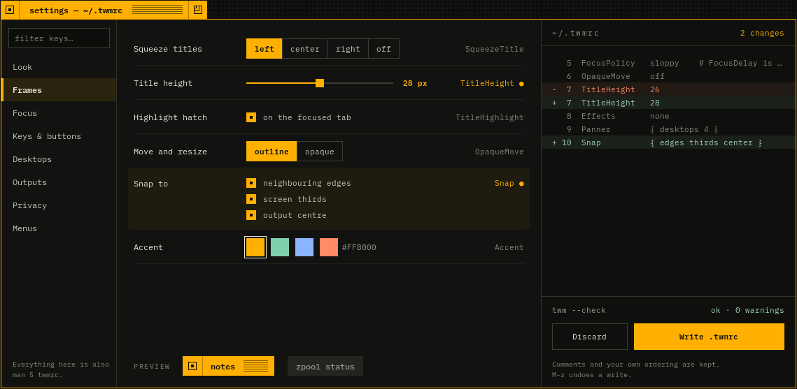

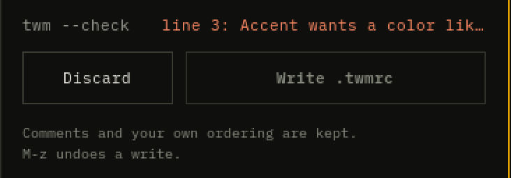

**Decided along the way** (recorded in DESIGN.md): SET-10 (compositor-drawn,
sizes, `M-,`, the menu entry), SET-11 (what each section holds; structures
read-only), SET-12 (the edit model, the diff), SET-13 (atomic writes),
SET-14 (keys), HIS-5 (undo order).

**Not done yet / not verified**
- Bindings, menus and Output rules are edited in the file, not in the
  window.
- The diff pane doesn't scroll; a long diff ends in `… N more`.
- Settings windows on more than one output, fractional scale, and FreeBSD
  are untested, like the rest.

## M6 — Polite urgency, capture markers, the trusted frame (2026-10-24)

**Done**

- Polite urgency (URG-1…5): asking for attention never takes the focus; the
  frame and the Icon Manager show it. `M-u` goes to the oldest urgent window
  (switching desktop, deiconifying) and `M-u` again comes back. Quiet
  desktops (`Quiet { 2 }`, or B3 on a desktop button) hold their windows'
  urgency, shown as `quiet`, until you visit.
- Capture markers (CAP-1…6): a client capturing through wlr-screencopy or
  ext-image-copy-capture gets `● SCREEN` in its tab and on its Icon Manager
  row, until 2 s after its last frame; inside a tab group too. A capture with
  no window writes a root line that stays while it lasts
  (`capture  grim is recording DP-1`). No setting turns them off.
- The trusted frame (TRU-1…8): prompts only twm draws, as on B6 — accent
  border, a 10 px weave band, a lock in the tab, `system · <purpose>`, hatch,
  no resize box, the desktop dimmed 35 %. While one is open every key and
  button goes to it, clients get neither focus nor pointer, and virtual
  keyboards and pointers go nowhere (only `--test`'s own program may answer,
  so the tests can). Prompts queue; focus comes back when they close.
- `twm --choose`: a dmenu-style chooser for xdg-desktop-portal-wlr, so screen
  sharing asks in the trusted frame.
- D-Bus through sd-bus (libsystemd, or basu on FreeBSD): the portal backend
  `org.freedesktop.impl.portal.desktop.twm` answers Access dialogs (choices
  as rows and a checkbox, `Request.Close` withdraws); notifications become
  root lines when no other daemon runs (`Notifications on|off`); as the
  session, twm updates the D-Bus/systemd activation environment. Portal
  files in `data/`.

**Screenshot test** `shot-m6_calm` (32 checks): held urgency on a quiet
desktop (`M-u` has nowhere to go), asking without taking focus, the urgent
outline, `M-u` there and back, the visit releasing held urgency; a helper
process capturing gets the marker in its tab and Icon Manager row, keeps it
when grouped (whichever tab is in front), loses it when it stops; a
windowless capture's root line comes and goes; the chooser's anatomy (accent
frame, weave band, lock, no resize box, the dim), another client's synthetic
click and Return ignored, Down/Return printing the chosen line, focus coming
back, Esc denying; an Access dialog over D-Bus answered with its choices,
`Request.Close` withdrawing one; a notification as a root line. Tests now run
on a private D-Bus (`dbus-run-session`). All 19 suites stable over repeated
runs and under load; the build without D-Bus (`-Dportal=disabled`) compiles.

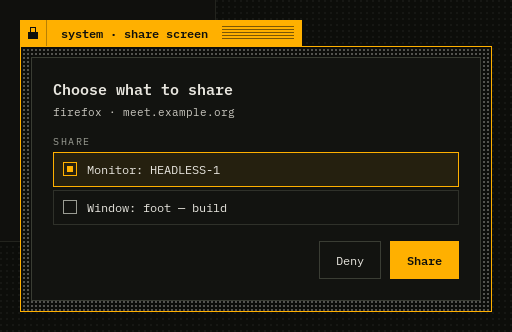

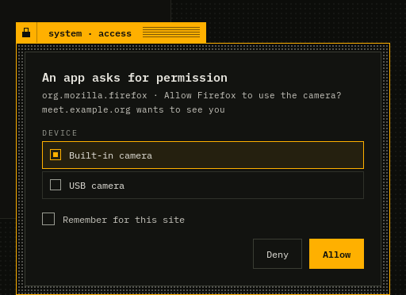

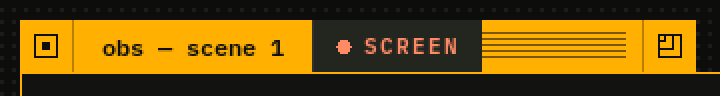

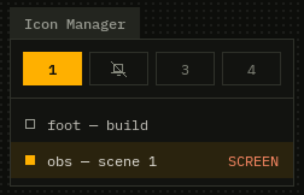

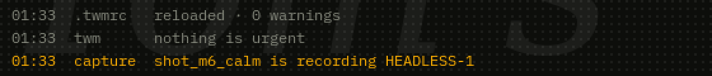

**Decided along the way** (recorded in DESIGN.md): CAP-4 (square markers in
prompts, not radio circles), CAP-5 (what twm can mark, groups), CAP-6 and
TRU-7 (`--test` trusts its own program only), TRU-7 (headings and buttons
are twm's words; portal button labels ignored), TRU-8 (the chooser, the
Access mapping), D-10 (D-Bus, notifications, activation environment only
when twm is the session).

**Found along the way**: a capturing window in a tab group lost its marker
(the row didn't redraw for a hidden tab, and the Icon Manager said `tabs`);
both fixed, and the test covers it. The fix also redraws a group's row when
a hidden tab's title changes.

**Not done yet / not verified**
- Portal ScreenCast is captured by xdg-desktop-portal-wlr, so the marker
  names xdpw (a root line), not the app sharing. Marking the app, and
  `MIC`/camera markers, need twm's own ScreenCast backend with PipeWire — a
  new dependency, your call.
- Polkit password prompts: the frame is ready, the agent needs
  libpolkit-agent — also your call.
- Not tried against a real xdg-desktop-portal and xdpw in a desktop session
  (the tests call the backend over D-Bus directly); FreeBSD/basu only in CI,
  which still hasn't run (no git remote).

## M5 — Tab groups and hint mode (2026-10-24)

**Done**

- Tab groups (GRP-1…8): B2-drag a window onto another frame's top edge and
  they share one frame. While dragging over a target, B2's preview replaces
  the outline: a floating tab under the pointer, a dashed slot opening in the
  target row at the insertion point, `DROP → GROUP OF N`. The row (B2):
  squeezed tabs, a 38 px hatch inside the active tab, separators, buttons in
  their neighbour tab's colors. B1 on a tab brings it to the front, `M-Tab`
  cycles, B3 folds and fans out; B2 drags a tab off to stand alone. Move,
  resize, send and iconify act on the group; joining and leaving are undoable.
- The Icon Manager shows a group as one row, `foot ×3` / `tabs`; the filter
  still finds each tab. The Panner shows the active tab.
- Hint mode (HNT-1…5): `M-;` letters every visible tab, nearest the pointer
  first (two letters past the home row); typing one raises and focuses it;
  Esc or another key leaves; it holds the keyboard.
- Pure modules with unit tests: the group tab-row layout and hint codes
  (`unit-group`).

**Screenshot test** `shot-m5_groups` (32 checks): the drop preview (slot,
floating tab, label) for a group of 2 and of 3; the joining window takes the
group's size, its tab comes to the front with the hatch; B1 on a tab and
`M-Tab`; fold and fan out; `M-B1` moves the group and another tab shows it at
the new place; the Icon Manager row; dragging a tab off places it at its
outline, and undo puts it back; hint letters on the group and a window, `s`
focusing the group, Esc and a non-hint key changing nothing. All 18 suites
stable over repeated runs and under load.

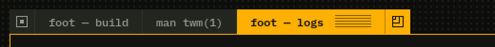

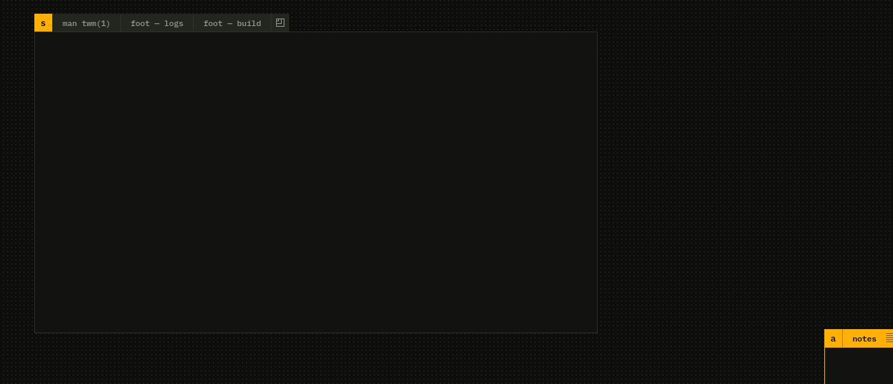

**Decided along the way** (recorded in DESIGN.md): GRP-1 (drop zone, dropped
tab in front, one tab at a time), GRP-5 (B2 drags a tab, other moves move the
group), GRP-8 (undo of grouping), HNT-2/3/5 details.

**Found along the way**: two windows with the same app id (two `foot`s)
were both restored to the remembered spot, the second on top of the first.
Remembered geometry now applies only to an app's first window (OUT-16). The
M5 test caught it.

**Not done yet / not verified**
- Dragging a whole group onto another to merge them isn't supported (one tab
  at a time).
- An unfocused group draws its active tab like the others; B2 only shows a
  focused group, so this is a guess.
- The selected hint's 60 ms frame isn't checked by a test (it's shorter than
  the screenshot's settle time).

## M4 — Icon Manager, root menu, desktops, Panner (2026-10-24)

**Done**

- Desktops (DSK-1, DSK-2, DSK-6): windows belong to a desktop; `M-1`…`M-9`
  switch instantly, `M-S-1`…`M-S-9` send; focus follows the most recent window.
- Iconify (FRM-13) with root icons (ROOT-9, ROOT-10): B1 on the icon
  deiconifies, B2 drags it; squeeze (FRM-14) shades a window to its tab.
  Iconify, deiconify, squeeze and send are recorded and undoable (HIS-1, HIS-2).
- Icon Manager (IMG-1…12): B0's rest state (desktop row, focused / normal /
  urgent / placing rows, divider, iconified rows) and B5's filter: typing at
  it lists WINDOWS (every desktop, iconified too), then RUN (menu entries,
  `$PATH` executables in `Terminal`); Return raises, `M-Return` brings here,
  Tab completes, Esc clears.
- Panner (DSK-3…5): desktop miniatures bottom-right; B1 switches, B2 drags a
  window to another desktop.
- Root menu (MNU-1…7): B1 on the root or `M-m`; press-drag-release or click
  and click; submenus; keys; shortcuts generated from the bindings; window
  functions pick their target with a crosshair click.
- Log window (ROOT-8, `M-n`).
- wlr-layer-shell (GEN-2), with exclusive zones honoured by placement, fit,
  snapping and twm's own windows.
- Internal views (twm-drawn windows) take buttons, keys and blur, so the
  Icon Manager and Panner are ordinary windows.

**Screenshot tests** `shot-m4_imgr` (58 checks) and `shot-m4_menu` (24):
the Icon Manager at rest and filtering, Return and `M-Return` from the
filter, desktop switching from keys and from the Icon Manager, sending and
the Panner's miniatures, iconify from the iconify box, the root icon and the
Icon Manager's iconified row, deiconify from both, dragging an icon, squeeze
and its undo/redo, the log window; the menu's anatomy and its B0 shortcuts,
keys, press-drag-release into "iconify" then a crosshair click, "move" then
click-click, the "desktops" submenu, and a 30 px bar that B3 fit stays under.
All 16 suites stable over repeated runs and under load.

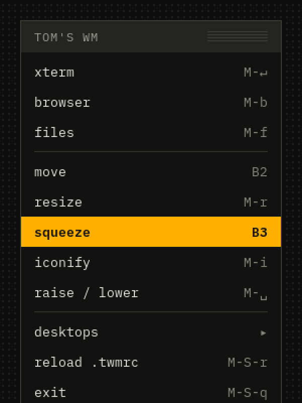

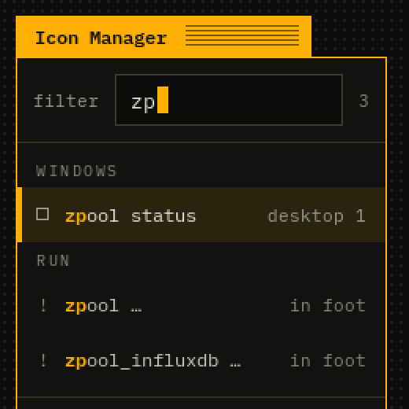

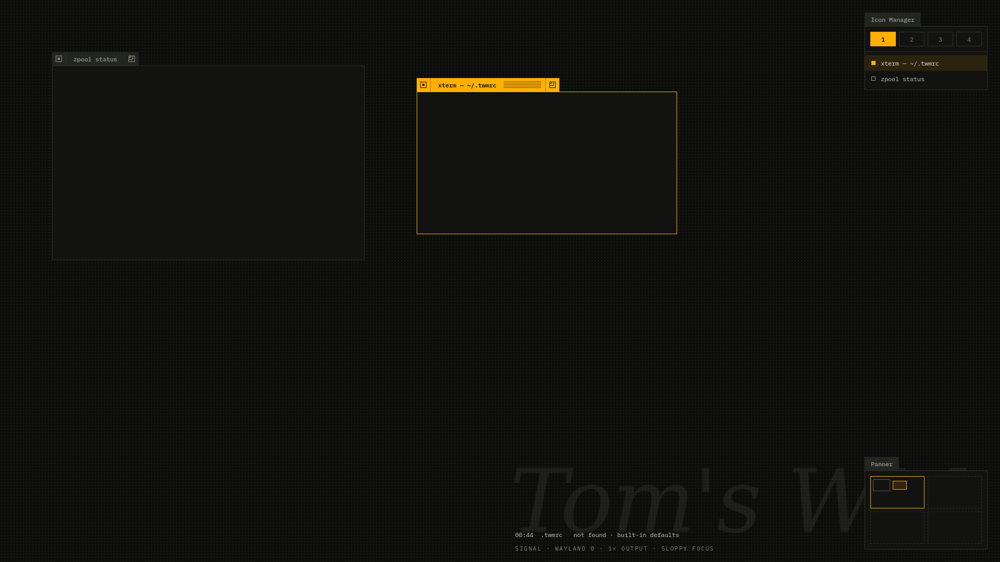

**Decided along the way** (recorded in DESIGN.md): IMG-11 (the filter sees
keys first, so `M-Return` can mean bring-here), IMG-12 (RUN details,
`Terminal "… %s"`), MNU-3 (title buttons before keys), MNU-5 (menu-started
moves end on a click), DSK-6 (desktop focus rules), root icons per desktop
(FRM-13), the layer-shell stacking (GEN-2), log window details (ROOT-8).

**Found along the way**
- Grab deltas were truncated with `(int)`, so an absolute pointer
  (999.9999) could land a window one pixel short; they're rounded now.
- wlroots counts a layer surface's exclusive zone only once it's mapped;
  twm re-arranges on map and unmap.
- Applying a config focused a window when nothing had focus, against FOC-9
  (caught by the M2 test when desktops arrived).

**Not done yet / not verified**
- Quiet desktops (URG-3: B3 on a desktop button, the held-urgency rows) are
  M6; B3 says so.
- Root icons use the app id's first letter; real app icons would need an
  icon-theme loader (a dependency question).
- The Panner's miniatures assume the first output; more outputs untested.
- Layer-shell exclusive keyboard grabs and popups are implemented but only
  the bar's exclusive zone is tested.

## M3 — Outlines that think (2026-10-24)

**Done**

- Snapping (SNP-1, SNP-2) during move, resize, placement and keyboard
  moves: neighbour frame edges (abutting and aligned), output edges, thirds,
  and the centre when `Snap { … center }`; within `SnapDistance`, nearest
  wins, frame edges beat thirds on a tie.
- Guides (SNP-3, SNP-4, SNP-6): a dashed accent line across the output for
  each snapped axis, labelled `EDGE · ZPOOL` / `⅓ HEIGHT`; faint thirds while
  dragging; `HEADLESS-1 · 1920×1080 · scale 1` in the corner. The readout's
  second line explains the snap: `left → zpool · top → ⅓` (SNP-5).
- M held = free (SNP-7): pressing the modifier during a drag stops snapping
  until it's released; the M of `M-B1` doesn't count.
- B3 fit while placing (OUT-13): the largest empty rectangle around the
  pointer, then placed.
- History (HIS-1, HIS-2, HIS-4): move, resize and place are recorded when
  they commit; `M-z` / `M-S-z` undo and redo per window; 100 entries.
- History view (HIS-3, `M-S-h`): the first window twm draws itself, built on
  a new internal-view module (FRM-18) that the Icon Manager and Panner will
  reuse in M4.
- Test client: a virtual keyboard, so keyboard bindings and outline keys now
  run end to end.

**Screenshot test** `shot-m3_snap`: 32 checks. B3 fit lands at exactly
1220×600+700+0 between two windows; `M-S-m` + arrows + Return moves by
(+3, +10) and Esc cancels; a B2 drag 4 px off zpool's edge and 3 px off the
⅓ line snaps to both, with both guides, both labels, faint thirds, the output
label and the hint on screen; the same drag with M pressed doesn't snap;
`M-z` ×4 walks back through three moves and stops at placing, `M-S-z` redoes;
the history view opens top-right with a title-only tab and shows a pending
row during a drag; Esc mid-drag leaves the window put. Unit tests:
`unit-snap` (B3's exact scene), `unit-history`. All suites stable over
repeated runs and under load.

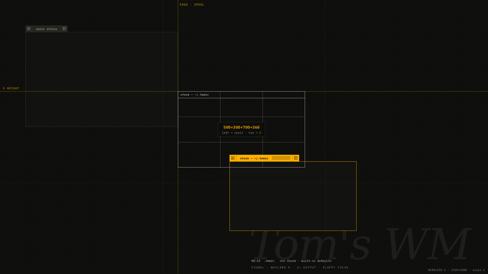

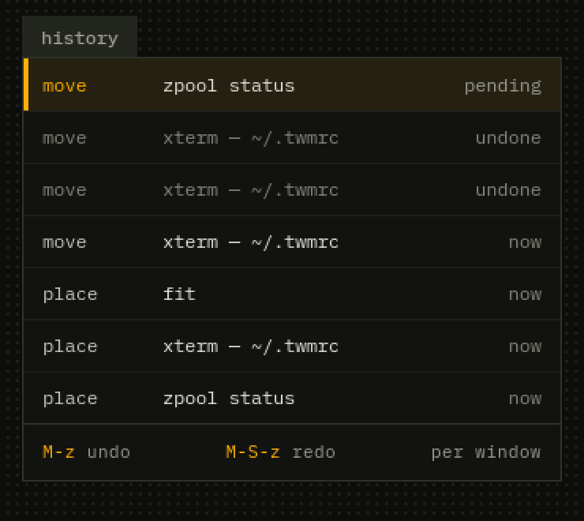

**Decided along the way** (recorded in DESIGN.md): placing isn't undoable
(HIS-2); neighbour names are the title's first word, `OUTPUT EDGE` for
output edges (SNP-3); B3 fit places at once (OUT-13); history view details
(HIS-3); utility windows are ordinary views (FRM-18, moved to M3).

**Found along the way**: wlroots doesn't derive modifier state from a
virtual keyboard's keys, so the test client tracks it and sends it; two of
my position checks were loose enough to pass for a window that hadn't moved,
and now probe the frame's exact corner. The M1 and M2 screenshot tests place
windows at exact spots, so they run with `Snap off`.

**Not done yet / not verified**

- Undo covers move, resize and place; iconify, squeeze, group, send and
  config writes join as they arrive (M4, M5, M7).
- The history view sits where the Icon Manager will go (top-right); M4
  decides how the two share that corner.
- Snapping uses the output under the pointer; outlines spanning two outputs
  only snap to that one. Untested with more than one output.

## M2 — Config (2026-10-24)

**Done**

- `.twmrc` parser (CFG-2, CFG-8): settings, `ButtonN = …`, key bindings,
  menus, blocks, `!"cmd"`. Lossless: nodes keep byte spans into the kept
  source, ready for Settings (M7) to rewrite one value. Syntax in
  DESIGN §5.1. Fuzzed with 200,000 mutated inputs under ASan/UBSan.
- Settings registry (CFG-3, CFG-10): every key in DESIGN §5, typed and
  range-checked, with plain error messages. The built-in defaults are
  `.twmrc` text read by the same code; user bindings replace built-in ones,
  `f.nop` unbinds, `NoDefaultBindings` drops them (CFG-14). B0's sample
  passes with 0 warnings, B8's keys are valid, and B7's misspelling gives
  B7's error at its line (CFG-9).
- `twm --check [file]` (CFG-4), `-f file` / `$TWMRC` / `~/.twmrc` (CFG-1).
- Hot reload (CFG-5…7): the file's directory is watched (inotify; kqueue on
  the BSDs), saves are debounced and ignored when the text didn't change;
  `M-S-r`, `f.reload` and `twm --reload` force it. A config with errors is
  never applied: the old one keeps running and the root line says why.
  `twm --reload` talks to a UNIX socket and prints the same text as `--check`
  (CFG-12).
- Applying a config live: accent, font, title height, border width, hatch,
  weave, wordmark, squeeze justification, `NoTitle`, focus delay and policy
  (FOC-7), `OpaqueMove` (OUT-11), `Placement cascade`, `Modifier`,
  `RaiseOnClick`, `Scale` and `Output` rules.
- Keys and buttons now come from the config (KEY, FRM-12); functions from
  later milestones answer on the root line ("f.iconify arrives in M4").
- Root line (ROOT-5…7): `HH:MM  source   message`, three lines at most above
  the status line, errors in accent, gone after `RootLineTimeout`.
- Geometry per app id (CFG-11, OUT-16): `$XDG_STATE_HOME/twm/geometry`,
  saved at most once a second by atomic rename; a known window opens where it
  was (sized at its first configure, so it doesn't jump), unfocused, with a
  `restore` line.
- Programs launched from bindings get an activation token, so the window the
  user asked for may take focus (FOC-9).

**Screenshot test** `shot-m2_config`: 27 checks. twm starts with no config;
the test writes one and the watcher applies it (mint accent, 30 px tab, 2 px
border); a broken file is refused with the old look kept and the error on
the root line in accent; `twm --reload` and `twm --check` give the expected
text and exit codes; a fixed file applies; an opaque B2 move moves the
window itself; the window comes back at its remembered spot, unfocused, after
being closed; click focus ignores hovering. Unit tests: `unit-twmrc`,
`unit-settings` (57 checks), `unit-geomem`. All suites stable over repeated
runs and under CPU load.

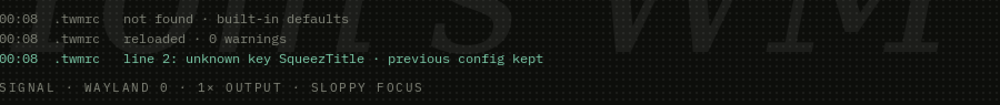

**Decided along the way** (recorded in DESIGN.md): CFG-13 (startup errors
fall back to defaults), CFG-14 (defaults as text; override per trigger),
CFG-15 (duplicates warn), §5.1 (`#RRGGBB` vs comments, unshifted key names),
ROOT-6 (lines are removed at once), FOC-9 (launch tokens), OUT-16 (`from
earlier`).

**Fixed along the way**: the status line said `SLOPPY FOCUS` regardless of
`FocusPolicy`; a parse error inside an unclosed block leaked memory.

**Not done yet / not verified**

- ROOT-8, the log window behind `M-n`, is M4 (the root line keeps 200
  messages for it).
- The key-binding input path (unshifted keysyms, modifiers) is unit-tested
  through the matcher, but the screenshot tests still have no virtual
  keyboard, so `M-S-r` and friends aren't driven end to end.
- The kqueue watcher is written but untested (no FreeBSD machine here; CI
  would cover it once the repository has a remote).
- `Output` mode and position, and `Scale`, are applied but untested: the
  headless output has no mode list and only scale 1 is exercised.
- Changing `XWayland` takes effect at the next start (the root line says
  so).
- App notifications on the root line (B7's `mutt` line) need a D-Bus
  notification service: an M6 dependency question.

## M1 — Frames (2026-10-23)

**Done**

- Frames (FRM-1…3, 5…12, 15…17, 19): squeezed tab with iconify box, title,
  highlight hatch and resize box, drawn as one pixman buffer; 1 px border.
  Focused, unfocused and urgent states, the urgent border dashed 3/3 with a
  continuous phase. Fixed-size clients get no resize box.
- Text with fcft (D-3): IBM Plex Mono at the output scale, cut with "…"
  when it doesn't fit.
- Server-side decorations always (FRM-15): xdg-decoration and the KDE
  protocol.
- Sloppy focus with intent (FOC-1…10): keyboard focus moves after the
  pointer rests 80 ms on a frame; pointer focus is immediate; a press focuses
  at once; focus never raises.
- Outlines (OUT-1…10): B2 on a title, B1-drag on a title, `M-B1`, resize box,
  `M-B3` by 3×3 grid, `M-S-m` / `M-r` from the keyboard. Rule-of-thirds
  outline with the window's name and a live `W×H+X+Y` readout; the client is
  configured once, on release. `Esc` cancels, `Return` commits, arrows nudge.
- Click-to-place (OUT-12, 14, 15): new windows wait with their outline
  hanging from the pointer; B1 places, B2-drag sizes, `Esc` places where it
  is; a queue for several; transients open over their parent; X11
  `USPosition` is kept.
- Urgency (URG-2, M1 part): an xdg-activation request whose token isn't tied
  to input on the focused client marks the window urgent; the X11 urgency
  hint does too. Focusing clears it.
- Root wordmark and status line (ROOT-2, ROOT-3).
- Pure modules with unit tests: `squeeze.c` (tab layout), `geometry.c`,
  `intent.c` (focus state machine on a fake clock).

**Screenshot test** `shot-m1_anatomy`: 91 checks. B0's windows are placed by
clicking where B0 puts them, then checked pixel by pixel against the frame
anatomy (box sizes, separators, hatch period and 8 px gap, borders, the 80 px
focus growth, the dash pattern), plus focus timing (a 25 ms crossing doesn't
move focus, an 80 ms rest does, the root never takes it), the placement
outline and readout, a mid-drag move that leaves the window in place, and a
resize that reaches the client once. Stable over repeated runs and under CPU
load.

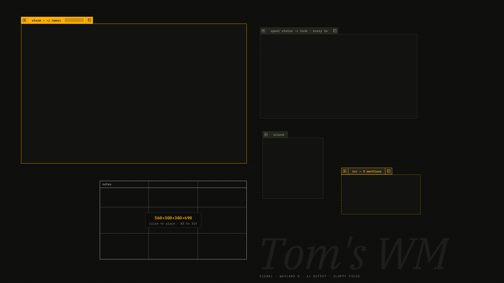

**Decided along the way** (recorded in DESIGN.md)

- FRM-11: B0's 0.3 px letter-spacing on the focused title is dropped. With
  it, the title shifted by ~9 px on every focus change; now only the hatch
  and its gap appear (exactly 80 px).
- FRM-5: when a title doesn't fit, it is cut before the hatch shrinks, since
  the hatch is the focus texture (P-5).
- Transients take focus if their parent had it (OUT-15).

**Not done yet / not verified**

- FRM-13 iconify and FRM-14 squeeze log "not available yet" (M4).
- `SqueezeTitle` center/right/off is implemented in the layout code and
  unit-tested, but only `left` is reachable until the config exists (M2).
- The keyboard paths (`M-S-m`, `M-r`, `Esc`, `Return`, arrows) are not
  covered by the screenshot test: the test client has no virtual keyboard
  yet.
- Resizing from the top or left edge moves the frame before the client has
  committed its new size, so it can jump for a frame.
- GEN-3: frames are drawn at the largest output scale, but 1 px lines are
  not yet snapped to the device grid at fractional scales; nothing has been
  tested at a scale other than 1.
- Text uses per-character kerning; harfbuzz text-run shaping (D-3) is not
  wired in yet.
- Instrument Serif isn't installed on the dev machine, so the wordmark falls
  back to the system serif italic; IBM Plex Mono is used for everything else.
- CI still hasn't run (no remote).

## M0 — Skeleton (2026-10-23)

**Done**

- meson build, C17. wlroots 0.20.2 comes from the system when available,
  otherwise from a pinned subproject together with the wayland 1.26.0,
  libdrm 2.4.134 and pixman 0.46.4 releases it needs (D-2). Debian 13 takes
  that path; Arch uses its packages.
- tinywl's structure split into modules: `server`, `output`, `input`, `view`
  (one type over xdg-shell and XWayland), `xdg`, `xwayland`, `root`, `draw`,
  `pixbuf`, `theme`.
- GEN-4: runs nested under Wayland and X11 (checked by hand), on a TTY
  through wlroots' session support (not yet tried on hardware), and headless
  with `--headless WxH`.
- GEN-6: XWayland starts lazily; `--no-xwayland` turns it off.
- GEN-7: `twm --version`, `twm --help`.
- ROOT-1: every output's root is `ground` with the 6 px dot weave, drawn
  into a pixman buffer at the output's scale and kept continuous across
  outputs.
- `-s <cmd>` and `--exit-with-startup` (exit with the command's status),
  which the screenshot tests use.
- Test harness (D-7): a Wayland test client (xdg-shell windows,
  virtual-pointer input, screencopy capture, PNG writer with no libpng),
  `tests/run-shot.sh`, unit tests for the pure modules.
- CI workflows for Arch, Debian 13 (subproject path) and FreeBSD 14.3.

**Screenshot test** `shot-m0_root`: 11 checks — output size, weave colors and
period over a 60×60 patch and at the far corner, and a client window
reaching the screen.

**Not verified**

- CI has not run yet: the repository has no remote. The FreeBSD job's
  package names (`wlroots020`, `ibm-plex`) are a best guess; the job falls
  back to the subproject when the wlroots package is missing.
- TTY/DRM start on real hardware.

**Found along the way**

- pixman's solid fills don't clip to the image. The weave overflowed its
  buffer on outputs whose size isn't a multiple of 6 (seen nested in X11 at
  1024×768). All fills now clip; `unit-draw` guards it.
- wlroots 0.20's pixman renderer requires pixman ≥ 0.46 while its top-level
  check accepts 0.43, so twm resolves pixman before wlroots.
